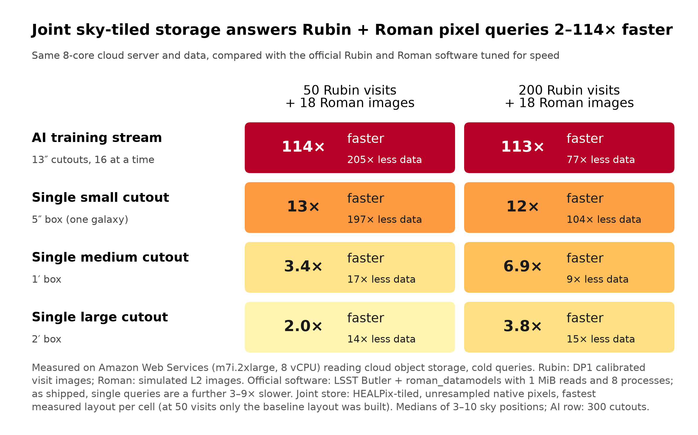

# astro-chunking-bench

**Does re-chunking Rubin (LSST) and Roman pixels by sky position — without resampling — make small-region, multi-survey reads faster and cheaper than the archives' native formats?**

This repository holds the code, results, figures and reports of a benchmark. It compares a **joint HEALPix sky-tile store** with each survey's native files and official software:
- **Joint store:** native, unresampled pixels from both surveys, cut into ownership-masked stamps per 13″ HEALPix tile, with both surveys co-located in the same objects.
- **Rubin native:** DP1 `visit_image` FITS, read with the LSST Butler.
- **Roman native:** I-Sim L2 `cal.asdf`, read with `roman_datamodels`.

The final round ran on AWS against real S3.



**Headline (v5, AWS us-east-2, 8 vCPU, real S3).** These are on the same server and data, against the official software tuned for speed:
- AI-style cutout streams are about **110× faster**.
- Single cutouts are **2–13× faster**.
- The joint store moves **9–205× less data**.
- With the official software as shipped, single cutouts are a further 3–9× slower.

## Reports (read in order)

| report | what it tests | key result |
|---|---|---|
| [reports/report.md](reports/report.md) | v1: OpenUniverse2024 Rubin + Roman sims, joint tiles vs native files, timed on Cloudflare R2 | 62–180× fewer bytes, ~10× faster at 5″; emulator bytes matched R2 exactly |
| [reports/report_v2.md](reports/report_v2.md) | v2: real Rubin DP1 visit images + Roman I-Sim L2, depth 10–200 visits | 4–15× faster cold, 9–315× fewer bytes; Roman ASDF reads dominate native cost |
| [reports/report_v3.md](reports/report_v3.md) | v3: band ordering inside the store | single-band slowness traced to large Parquet footers; per-band vs tile-major trade-offs |
| [reports/report_v4.md](reports/report_v4.md) | v4: AWS side-by-side with the official stacks (in-AWS Butler, `roman_datamodels`) on real S3 | 2–9× faster than best-effort official, 10–88× faster than out-of-the-box; Butler's s3fs 50 MiB read block; WCS fidelity (§5b) |
| [reports/report_v5.md](reports/report_v5.md) | v5: process-parallel decode, AI-style concurrent load, layout variants | ~110× official throughput under AI load; blob + index layout 21–32% faster per query |
| [reports/native_formats.md](reports/native_formats.md) | how each archive stores and compresses pixels | both archives compress pixel data losslessly but barely (Rubin IMAGE 1.10×, Roman data ~1.0×) |

## Layout

```
code/      benchmark and store code (flat; scripts import each other from the working directory)
  chunkbench.py      HEALPix tiling, ownership stamps, codecs, Parquet writers
  readers.py         native readers (Rubin FITS, Roman ASDF/gz), HatsPixelReader, S3 emulator
  joint2.py          v5: blob + index store, mask-aware assembler, ParallelTiled
  s3session.py       boto3 transport with the readers' get(url, range) interface
  bench_v2.py, bench_v3.py, ai_v2.py, r2_bench.py, real_s3_baseline.py, fetch_v3.py, ...   local / emulator rounds
  aws_*.py, bench_common.py, run_v5.sh, wcs_check_*.py                                      AWS rounds (v4, v5)
  patch2.json        the 4′ DP1 benchmark patch (also in data/)
aws/       AWS runbook, bootstrap script, S3 bucket-policy template
data/      exposure manifests (DP1 visit list, Roman L2 list, store exposure table with WCS headers), patch definition
results/   raw per-query results (parquet) and summary tables (csv) for every round
figures/   all report figures (PNG; policy grid also as PDF)
reports/   the write-ups above
```

## Reproducing

- **Local and emulator rounds (v1–v3):** conda env with numpy, pandas, pyarrow, astropy, astropy-healpix, scipy, blosc2, requests, boto3, asdf and roman_datamodels.
  - Astropy needs `XDG_CONFIG_HOME` / `XDG_CACHE_HOME` pointed at writable directories in sandboxed environments.
  - The DP1 pixels need Rubin data rights: an RSP token, used with `lsst-daf-butler[remote]` against `https://data.lsst.cloud/api/butler/repo/dp1/butler.yaml`, collection `LSSTComCam/DP1`.
- **AWS rounds (v4–v5):** follow [aws/aws_runbook.md](aws/aws_runbook.md).
  - Instance: m7i.2xlarge in us-east-2, with the LSST Science Pipelines (`lsst_distrib` w_2026_47) and a `roman` conda env.
  - Pipeline: the DP1 visits are copied into an in-AWS DirectButler with `aws_butler_transfer.py` and `aws_butler_to_s3.py`. Note that `Butler.makeRepo(..., forceConfigRoot=False)` is required for an S3 datastore root.
  - Then `aws_build_stores.py` / `aws_build_variants.py` build the stores, and `aws_bench_*.py`, `aws_ai_load.py` and `run_v5.sh` run the benchmarks.
  - Host-generated files that are not in the repo: `butler_transfer.json` (the S3 URIs of the transferred datasets) and the stores themselves (about 64 GB).
- **Roman source data:** STScI's public `s3://stpubdata/roman/nexus/soc_simulations/r00342/l2/` (anonymous). The file list is [data/roman_files.txt](data/roman_files.txt).

## Caveats

- One 4′ sky patch and one instance type.
- Roman data are simulations; their WCS is re-anchored onto the DP1 patch (CRVAL shift only).
- Cold-query medians are over 3–10 positions; the AI-load runs use 50–300 queries.
- The official-stack AI throughput is derived from separate Rubin and Roman runs.
- See each report's caveats section for the rest.
