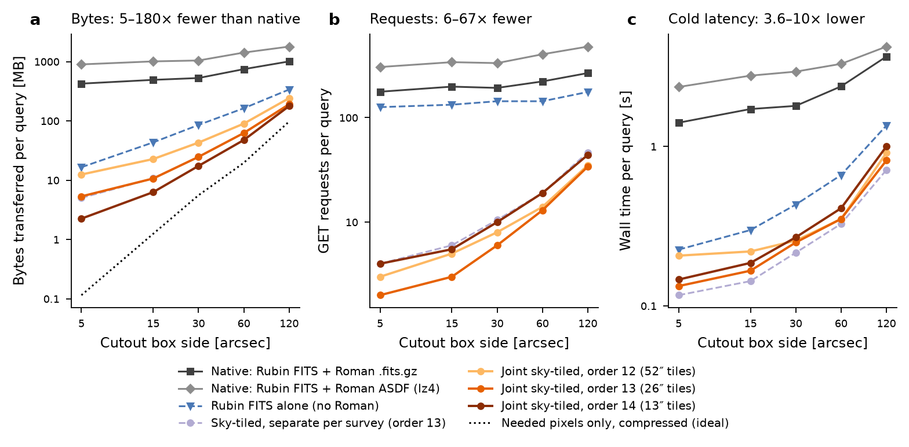
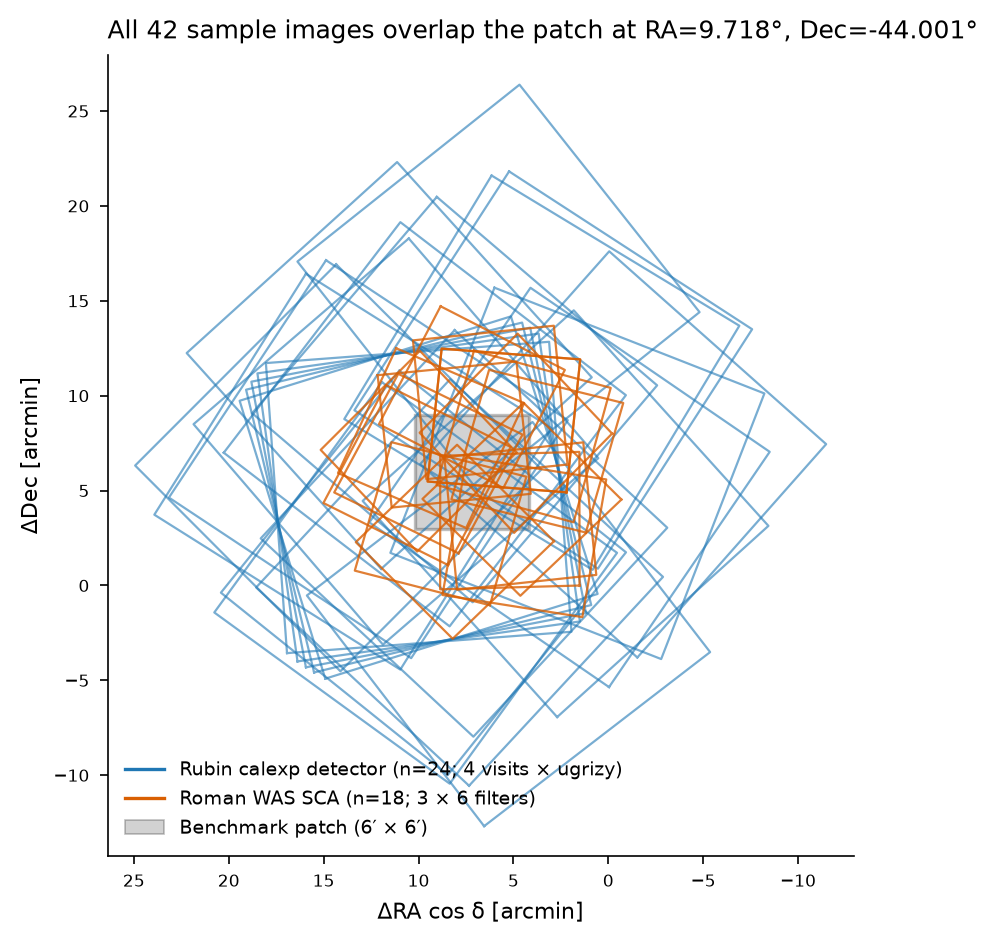
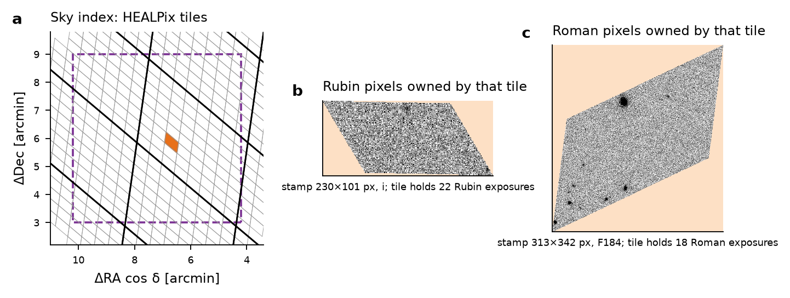
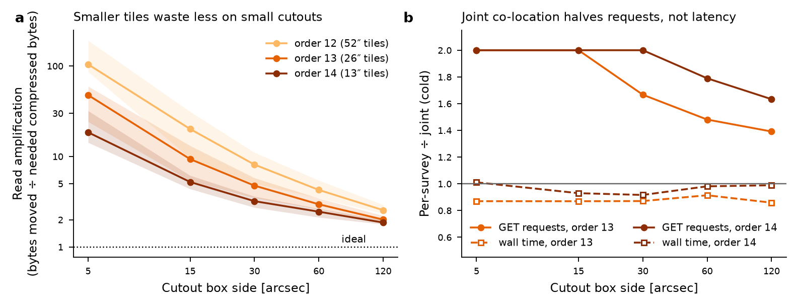
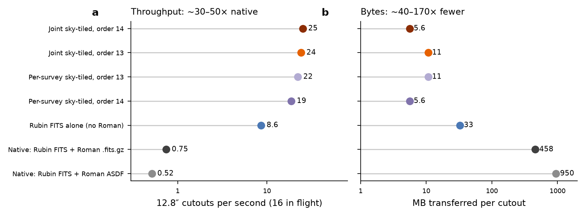

# Joint sky-chunking of LSST (Rubin) and Roman pixels: first cloud read benchmark

**Question.** Rubin and Roman images are stored by exposure and detector. Suppose we keep every native pixel unchanged (no resampling) but re-chunk both surveys together by sky region, with one HEALPix tile holding every Rubin and Roman pixel that falls in it, compressed together. Does that make small-region, pixel-level joint reads faster and cheaper on cloud object storage, especially for AI-style access?

**Short answer: yes, by a large margin.** Almost all of the gain comes from sky-aligned chunking. Putting both surveys in the same object adds a further 1.4–2× cut in GET requests but no latency gain. Median cold reads on the S3 emulator, for a query returning all Rubin and Roman native pixels (image + noise + mask planes):

- **5″ box:** 62–180× fewer bytes, 47–67× fewer GETs and about 10× faster than the native layout (Rubin FITS + Roman `.fits.gz`).
- **120″ box:** about 5× fewer bytes, 6–8× fewer GETs and 3.6–4.4× faster.
- **ASDF baseline:** the gains are larger against Roman's delivery format: up to 17× faster cold and 23× with a warm index.
- **Real cloud:** on your Cloudflare R2 bucket (read from this laptop), the joint store was 22–30× faster at 5″ and 5–6× faster at 120″. R2 byte counts matched the emulator exactly.
- **Storage:** about the same as the native files (1.02 GB vs 1.01 GB for the same pixels).
- **Validation:** every reconstructed cutout is **bit-identical** to the original files.

## 1. Data
- **Source:** OpenUniverse2024 preview (IRSA, AWS Open Data; `s3://nasa-irsa-simulations/openuniverse2024/`). These are matched simulations of the same sky by Rubin and Roman.
- **Patch:** 6′×6′ at RA 9.718°, Dec −44.001°. **24 Rubin `calexp`** (4 visits in each of *ugrizy*) and **18 Roman WAS `simple_model` SCAs** (3 in each of 6 filters). Sample list: [sample_manifest.parquet](../data/sample_manifest.parquet).
- **Coverage:** each exposure covers 19–100% of the patch, so a query hits a realistic, varying subset. The median is 26–40 exposures per query.

## 2. Native layouts (audit: [native_formats.md](native_formats.md))
- **Rubin calexp:** FITS tile compression, lossless `GZIP_2` (byte-shuffle + gzip), **4096×1 row tiles**, 3 planes. Partial reads are possible, but a cutout costs full 4096-pixel rows in every plane.
- **Roman (these sims):** **whole-file gzip** `.fits.gz`, so no random access. DQ is the last HDU, so effectively the whole file must be streamed.
- **Roman ASDF:** I built an ASDF copy of each SCA with lz4 block compression, the `roman_datamodels` default since 0.23. Each array is one compressed block, so a cutout costs the full blocks.

## 3. Layouts compared
| id | layout | per-query I/O pattern |
|---|---|---|
| native:gz | Rubin FITS (best-case range reader) + Roman `.fits.gz` (stream, stop after last needed row) | about 7 GETs per Rubin file (index + 3 planes); whole Roman files in 8 MiB parts |
| native:asdf | Rubin FITS + Roman ASDF via the `asdf` library | whole lz4 blocks |
| persurvey:k | sky-tiled store **per survey** (control) | footer + one coalesced range per run of tiles, ×2 surveys |
| joint:k | **joint** sky-tiled store, Rubin+Roman co-located | footer + one coalesced range per run of tiles |

**Joint store design** (code: [chunkbench.py](../code/chunkbench.py); index: [exposures.parquet](../data/exposures.parquet)):
- **Tiling and files:** HEALPix NESTED tiles at order *k* = 12, 13 or 14 (52″, 26″, 13″), in a **HATS-style Parquet** layout (`Norder=10/Dir=0/Npix=N.parquet`). Each order-10 partition is one file, and each order-*k* tile is one row group. NESTED ordering keeps neighbouring tiles contiguous on disk, so multi-tile queries coalesce into few range requests.
- **Stamp rows:** each row group holds, for every overlapping Rubin and Roman exposure and every plane, the **native-pixel stamp** of the pixels whose centres fall in the tile. Each row carries its parent-pixel offsets (exact WCS recovery via the parent header and CRPIX shift).
- **Exact ownership:** each pixel is stored once, with a packed ownership bitmask, so there is no duplication from bounding boxes of the diamond-shaped HEALPix tiles.
- **Codec:** pixels use blosc2 zstd-5 + bitshuffle, lossless, with the original dtypes kept (Rubin float32/int32; Roman float64/float32/uint32).
- **Why Parquet rather than Zarr:** Zarr v3 sharding co-locates chunks of *one* array only, so it cannot put Rubin and Roman stamps in the same object.

**Storage** ([storage_overhead.csv](../results/storage_overhead.csv)):
- **Joint store:** 971 / 1021 / 1112 MB at orders 12 / 13 / 14.
- **Native files, same pixels:** 1007 MB with Roman `.fits.gz` (Rubin 652 + Roman 355), or 1369 MB with Roman ASDF.
- **Overhead:** none at orders 12–13; +10% at order 14, from per-stamp framing.

## 4. Method
- **Query:** a square box of side 5, 15, 30, 60 or 120″ at a random position in the patch. It returns, **for every overlapping exposure, the axis-aligned native-pixel rectangle** (image, variance/err and mask/dq). This is the same definition for every layout.
- **Sample sizes:** 30 positions per size for the tiled layouts and Rubin FITS; 6 positions for the whole-file Roman formats. Results are paired on identical positions.
- **Index modes:** *cold* (no cached index) and *warm* (Parquet footers and FITS HDU offsets cached).
- **Transport:** all reads are HTTP-style range GETs through one transport layer. Large ranges are split into parallel 8 MiB parts, as S3 SDKs do.
- **Main testbed:** an in-process **S3 emulator** with 30 ms time to first byte, 90 MB/s per stream and a shared 10 Gb/s link, roughly an in-region EC2 → S3 client. It counts exact bytes and GETs.
- **Real-cloud anchors:** (i) the native files read in place on IRSA S3 (laptop → us-east-1); (ii) your **Cloudflare R2** bucket `astro-chunking-bench`, holding every layout at the same endpoint (laptop → R2).
- **Correctness:** 90 query × order × layout combinations were checked **bit-identical** against direct slices of the original files. Two bugs found and fixed on the way: `astropy_healpix` cone search is not inclusive for these elongated tiles, and field distortion pushes box corners past the nominal radius. Tile selection is now an exact neighbour search with a radius taken from each exposure's distorted box corners.

## 5. Results
### 5.1 Single cutout queries (emulator, cold, median)
Bytes moved per query [MB] ([benchmark_summary.csv](../results/benchmark_summary.csv)):

| layout | 5″ | 15″ | 30″ | 60″ | 120″ |
|---|---|---|---|---|---|
| Native: Rubin FITS + Roman .fits.gz | 425 | 492 | 528 | 746 | 1.01e+03 |
| Native: Rubin FITS + Roman ASDF (lz4) | 897 | 1.01e+03 | 1.04e+03 | 1.42e+03 | 1.79e+03 |
| Rubin FITS alone (no Roman) | 16.5 | 43.4 | 85.4 | 164 | 338 |
| Per-survey sky-tiled, order 13 | 5.02 | 10.7 | 24.8 | 62.6 | 187 |
| Joint sky-tiled, order 12 | 12.5 | 22.7 | 43 | 90 | 242 |
| Joint sky-tiled, order 13 | 5.33 | 10.7 | 24.7 | 62.5 | 191 |
| Joint sky-tiled, order 14 | 2.25 | 6.29 | 17.4 | 47.6 | 178 |

GET requests per query:

| layout | 5″ | 15″ | 30″ | 60″ | 120″ |
|---|---|---|---|---|---|
| Native: Rubin FITS + Roman .fits.gz | 177 | 198 | 192 | 222 | 267 |
| Native: Rubin FITS + Roman ASDF (lz4) | 305 | 340 | 332 | 404 | 478 |
| Rubin FITS alone (no Roman) | 126 | 133 | 144 | 144 | 176 |
| Per-survey sky-tiled, order 13 | 4 | 6 | 10 | 19 | 46 |
| Joint sky-tiled, order 12 | 3 | 5 | 8 | 14 | 35 |
| Joint sky-tiled, order 13 | 2 | 3 | 6 | 13 | 34 |
| Joint sky-tiled, order 14 | 4 | 6 | 10 | 19 | 44 |

Wall time per query [s]:

| layout | 5″ | 15″ | 30″ | 60″ | 120″ |
|---|---|---|---|---|---|
| Native: Rubin FITS + Roman .fits.gz | 1.41 | 1.72 | 1.80 | 2.38 | 3.67 |
| Native: Rubin FITS + Roman ASDF (lz4) | 2.36 | 2.78 | 2.95 | 3.30 | 4.23 |
| Rubin FITS alone (no Roman) | 0.23 | 0.30 | 0.43 | 0.66 | 1.35 |
| Per-survey sky-tiled, order 13 | 0.12 | 0.14 | 0.22 | 0.33 | 0.71 |
| Joint sky-tiled, order 12 | 0.21 | 0.22 | 0.26 | 0.35 | 0.91 |
| Joint sky-tiled, order 13 | 0.13 | 0.17 | 0.25 | 0.35 | 0.82 |
| Joint sky-tiled, order 14 | 0.15 | 0.19 | 0.27 | 0.41 | 1.00 |

Paired ratios, native ÷ joint, same positions, cold ([paired_speedups.csv](../results/paired_speedups.csv)):

| box | bytes ÷ (o13 / o14) | requests ÷ (o13 / o14) | speed-up vs .fits.gz (o13 / o14) | speed-up vs ASDF (o13 / o14) |
|---|---|---|---|---|
| 5″ | 62 / 180 | 66 / 47 | 9.8 / 9.6 | 16.7 / 15.3 |
| 15″ | 39 / 62 | 63 / 38 | 8.8 / 7.9 | 14.2 / 13.3 |
| 30″ | 22 / 30 | 33 / 20 | 8.5 / 6.9 | 13.1 / 11.4 |
| 60″ | 11 / 14 | 17 / 11 | 6.3 / 5.6 | 8.5 / 7.5 |
| 120″ | 5 / 6 | 8 / 6 | 4.4 / 3.6 | 5.0 / 4.3 |

### 5.2 What drives the gain

- **Chunk geometry is what matters.** Read amplification (bytes moved ÷ compressed bytes actually needed) for the joint store falls from 104 / 48 / 18.5× at 5″ (orders 12 / 13 / 14) to about 2× at 120″. The native Rubin row tiles move 16.5 MB for a 5″ box on Rubin alone. The joint order-14 store moves 2 MB for Rubin *and* Roman together.
- **Co-location in one object halves GETs but does not cut latency.** Against identical per-survey tiling, the joint store needs 1.4–2× fewer GET requests for the same bytes. Cold latency is not lower: the per-survey store is 0–14% *faster*, because the two survey streams download in parallel.
- **Under concurrent AI-style load the balance shifts.** Joint is 8–34% faster at 16 queries in flight (§5.3), and fewer requests also means lower GET cost and less request-rate pressure.
- **Best tile order depends on query size.** Order 14 (13″) is best for ≤30″ boxes. Order 13 (26″) costs fewer requests and is about equal at 60–120″. Order 12 is too coarse for sub-arcminute work.

### 5.3 AI-style batch access ([batch_results.parquet](../results/batch_results.parquet))
Workload: 300 random 12.8″ (64×64 Rubin-pixel) joint cutouts of all overlapping Rubin + Roman exposures, about 30 per position, with 16 queries in flight and a warm index.

| layout | cutouts/s | MB per cutout | GETs per cutout | n |
|---|---|---|---|---|
| Native: Rubin FITS + Roman ASDF | 0.52 | 950 | 249 | 32 |
| Native: Rubin FITS + Roman .fits.gz | 0.75 | 458 | 116 | 32 |
| Rubin FITS alone (no Roman) | 8.6 | 32.5 | 57.1 | 300 |
| Per-survey, order 13 | 22 | 10.7 | 4.85 | 300 |
| Per-survey, order 14 | 19 | 5.61 | 7.33 | 300 |
| Joint, order 13 | 24 | 10.7 | 2.58 | 300 |
| Joint, order 14 | 25 | 5.61 | 3.68 | 300 |

The joint store sustains **24–25 multi-survey cutouts/s**, against **0.75/s** (native `.fits.gz`) and **0.52/s** (ASDF), with 40–170× less data moved. That is a 32–49× throughput gain.

### 5.4 Real clouds
**Laptop → Cloudflare R2**, every layout at the same endpoint ([r2_results.parquet](../results/r2_results.parquet)). R2 byte counts equal the emulator's for all 45 cold queries.

| layout (cold) | 5″ wall s | 30″ wall s | 120″ wall s | 5″ MB | 120″ MB |
|---|---|---|---|---|---|
| Native: Rubin FITS + Roman ASDF (n=1) | 38.45 | 35.98 | 78.60 | 936 | 1748 |
| Native: Rubin FITS + Roman .fits.gz (n=2) | 14.98 | 17.14 | 44.63 | 365 | 1019 |
| Per-survey, order 13 (n=4) | 0.48 | 1.17 | 8.84 | 4.53 | 191.4 |
| Joint, order 13 (n=4) | 0.63 | 1.74 | 7.82 | 4.81 | 196.4 |
| Joint, order 14 (n=4) | 0.51 | 1.39 | 7.49 | 1.93 | 177.6 |

Paired speed-up of the joint store over native `.fits.gz` on R2: 22.5× (order 13) and 30× (order 14) at 5″; 9.8× and 15× at 30″; 5.2× and 6.1× at 120″. A home internet link is much narrower than an in-region link, so bytes dominate and the advantage grows. This is the regime of a user or an AI agent reading over the WAN.

**Laptop → IRSA S3**, native files as distributed ([real_s3_results.parquet](../results/real_s3_results.parquet)):

| native file, read in place on IRSA S3 | 5″ | 30″ | 120″ |
|---|---|---|---|
| Rubin calexps (all overlapping) wall s (MB) | 1.8 (15) | 4.3 (82) | 16.2 (342) |
| Roman .fits.gz (all overlapping) wall s (MB) | 17.8 (350) | 19.8 (387) | 30.5 (656) |

Byte counts match the emulator for the same queries. For the Roman whole-file gzip rows, one client-side double count was found and corrected, and the corrected value equals the emulator's to the byte.

## 6. Caveats
- **Simulated data.** OpenUniverse Roman WAS `simple_model` pixels are integer-valued, stored as float64, and DQ is all zeros. That makes Roman gzip unusually effective. Real Roman L2 data (ASDF, float32 rates) will compress less, which favours the tiled layouts further.
- **Emulator is a model.** It stands in for an in-region client (30 ms TTFB, 90 MB/s per stream). Real S3 adds tail latency and the 5,500 GET/s per-prefix limit, which also favours fewer requests. The laptop runs share one consumer link and include about 100–300 ms of WAN latency.
- **Generous baselines.** They get a free external index (which files overlap, and their WCS) and best-case readers. These are minimal-byte FITS row-tile reads and an early-stopping gzip stream, neither of which standard tools do. Real-world native reads would be slower.
- **No halo or margin.** Stamps hold exactly the owned pixels. Cutouts that need a halo (PSF, convolution) simply read neighbouring tiles. HEALPix tiles at Dec −44° are elongated (rhombi with about 2:1 axis ratio), which raises request counts slightly.
- **Small scale.** One 6′ patch with 42 exposures. Survey-depth stacks of hundreds of epochs per tile change the balance. Row groups grow, so per-epoch or per-band sub-partitioning (e.g. a `band` column with Parquet row-group statistics) becomes important.
- **Zarr not benchmarked.** A Zarr v3 per-survey sharded store would behave like the per-survey control: shard index plus chunk reads per array.

## 7. Recommendations for a follow-up
- **Run in-region.** Use an EC2 instance in us-east-1 against S3 (or an R2 worker) to replace the emulator with measured in-region numbers.
- **Use real Roman data.** Switch to Roman L2 ASDF products (or newer float32 simulations) and add a multi-epoch-depth test with 100+ Rubin visits per tile.
- **Default tile order:** HEALPix order 14 for ≤30″ science and AI cutouts. Consider an adaptive or multi-order scheme (HATS margin-cache style) for larger boxes.
- **Integrate with existing tooling.** Keep exact pixel ownership, native dtypes and per-stamp WCS. Expose the store through LSDB/HATS-compatible metadata, so catalog and pixel partitions share one sky index.
- **Test the in-process cost.** Measure GPU data-loader throughput, for example by streaming joint cutouts into a PyTorch `IterableDataset`, where request count and decode CPU will matter as much as bytes.

## 8. Artifacts
- **Code:** [chunkbench.py](../code/chunkbench.py) (geometry, ownership stamps, HATS writer); [readers.py](../code/readers.py) (all readers + emulator); [r2_bench.py](../code/r2_bench.py); [real_s3_baseline.py](../code/real_s3_baseline.py).
- **Results:** [benchmark_results.parquet](../results/benchmark_results.parquet) (2,220 emulator query runs); [benchmark_summary.csv](../results/benchmark_summary.csv); [paired_speedups.csv](../results/paired_speedups.csv); [batch_results.parquet](../results/batch_results.parquet); [r2_results.parquet](../results/r2_results.parquet); [real_s3_results.parquet](../results/real_s3_results.parquet).
- **Cloud copy:** 124 objects (7.88 GB) under `chunking-bench/` in R2 bucket `astro-chunking-bench`: joint orders 13–14, per-survey order 13, native FITS, `.fits.gz` and ASDF files, and `exposures.parquet`. Two tiny `_write_test.*` objects are also there.
