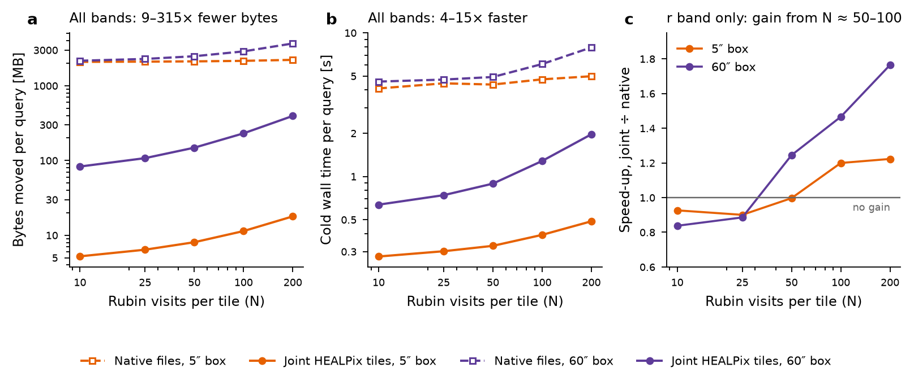

# Joint sky-chunking benchmark v2: real Rubin DP1 + Roman L2 pipeline files, depth sweep

This follow-up to [report.md (v1)](report.md) replaces the OpenUniverse simulations with **files in the format each project actually delivers as calibrated single exposures**, and scales Rubin depth from 10 to 200 visits per sky tile. Per your direction, the two surveys need not show the same sky.

## Inputs
| | Rubin | Roman |
|---|---|---|
| product | **real DP1 `visit_image`** (LSSTComCam, ECDFS), read with your RSP token | **STScI Roman I-Sim L2 `_cal.asdf`** (`stpubdata`, program r00342; high-latitude field near RA 9.6°, Dec −45.2°; 294 s exposures) |
| count | 200 visits (u 21, g 37, r 54, i 40, z 34, y 14), all fully covering a 4′×4′ patch at RA 52.971°, Dec −28.180° | 18 SCAs (3 each in F087, F106, F129, F146, F158, F184) |
| native layout | FITS tile compression, lossless `GZIP_2`, **4072×1 row tiles**; IMAGE f32 / MASK i32 / VARIANCE f32; about 106 MB per file | ASDF `WfiImage`, every array one **lz4 block**: data f32, err f16, dq u32, plus var_poisson, chisq, dumo, amp33 and reference-pixel arrays; about 205 MB per file |
| sky placement | native | gwcs converted to FITS-SIP (max fit error < 0.01 px); **only CRVAL** shifted onto the Rubin patch, with ±1.2′ dithers; pixels untouched |

Files: [dp1_manifest.parquet](../data/dp1_manifest.parquet), [roman_l2_expo.parquet](../data/roman_l2_expo.parquet). Patch depth map: [fig_dp1_depth.png](../figures/fig_dp1_depth.png).

**How the stores were built.**
- **Streaming:** each DP1 file was range-read for only the row tiles covering the patch and then discarded. That was 8.0 GB of reads in 7.5 min with 0 errors, using [dp1_extract.py](../code/dp1_extract.py).
- **Layout:** the joint store uses HEALPix **order 14 (13″ tiles)** in HATS-style Parquet. A new detail is that one row group holds **tile × survey × band**, so band-selective reads can skip data using the file footer.
- **Pixels:** stored with exact pixel ownership in their native dtypes, compressed with blosc2-zstd + bitshuffle.
- **Validation:** every depth was checked **bit-identical** against direct reads of the original FITS/ASDF files. All 10 checks passed (28–42 exposures each).

## Method
- **Testbed:** the in-process S3 emulator from v1 (30 ms to first byte, 90 MB/s per stream, 10 Gb/s shared link). In v1 its byte counts matched Cloudflare R2 exactly.
- **Queries:** 20 random positions per box size for the joint store; 5 for native, paired on the same positions.
- **Native readers:** Rubin uses the minimal-byte FITS row-tile reader. Roman uses the `asdf` library through range reads, as `roman_datamodels` does.
- **Depth for native Rubin:** native Rubin queries reuse a 24-file local subset (4 per band) as byte-identical stand-ins for deeper visits. Each query box comes from the real visit's own WCS, so the I/O pattern is that of real DP1 files.
- **Scripts and data:** [bench_v2.py](../code/bench_v2.py), [ai_v2.py](../code/ai_v2.py); raw results [emu_results.parquet](../results/emu_results.parquet), [summary_v2.csv](../results/summary_v2.csv), [paired_ratios_v2.csv](../results/paired_ratios_v2.csv).

## Results
### All-band, all-epoch joint cutouts (cold index)
Native ÷ joint, median of paired queries:

| Rubin visits N (exposures/query) | 5″ bytes ÷ | 5″ faster | 15″ faster | 30″ faster | 60″ bytes ÷ | 60″ faster |
|---|---|---|---|---|---|---|
| 10 (28) | 315× | 14.5× | 13.1× | 9.3× | 25× | 6.8× |
| 25 (43) | 253× | 14.5× | 13.0× | 8.3× | 20× | 5.6× |
| 50 (68) | 197× | 13.2× | 11.3× | 7.6× | 16× | 5.3× |
| 100 (118) | 137× | 11.5× | 10.4× | 7.1× | 12× | 4.5× |
| 200 (218) | 87× | 10.3× | 8.9× | 6.4× | 9× | 4.0× |

- **Native cost is dominated by Roman ASDF.** The `asdf` library reads about 115 MB per Roman file to serve *any* cutout: the full lz4 blocks for data, dq and err plus the tree. Across 18 SCAs that is a flat ~2.1 GB per query.
- **Rubin native cost grows with depth.** It scales with N times the number of rows touched, reaching 1,150 GETs per query at N = 200.
- **Joint store cost tracks the pixels actually needed.** 5″: 5.2 MB / 0.28 s at N = 10, rising to 18 MB / 0.49 s at N = 200. 60″: 83 MB / 0.64 s rising to 394 MB / 1.97 s.
- **The advantage narrows with depth** (14.5× → 10.3× at 5″) but stays large. Once the native per-file index is cached (warm), it is 17–47× at 5″.

### Single-band time series (Rubin r band only, joint store with band-split row groups)
Speed-up, joint ÷ native, cold:

| N | 5″ | 15″ | 30″ | 60″ |
|---|---|---|---|---|
| 10 | 0.93× | 0.95× | 0.78× | 0.84× |
| 25 | 0.90× | 0.95× | 0.92× | 0.89× |
| 50 | 1.00× | 1.11× | 1.02× | 1.24× |
| 100 | 1.20× | 1.37× | 1.33× | 1.47× |
| 200 | 1.22× | 1.59× | 1.63× | 1.76× |

- **Bytes:** the joint store always moves fewer bytes, 1.6–8.4× fewer.
- **Latency:** the joint store is *slower* at shallow depth (0.8–0.95× at N ≤ 25) and faster only from N ≈ 50–100, reaching 1.2–1.8× at N = 200.
- **Reason:** the native reader touches only the 4–54 r-band files, using about 7 GETs per file. Band-split row groups are interleaved with the other bands on disk, so a 60″ query needs about 53 separate ranges whatever N is.
- **Fix to test next:** within each partition, sort rows by (survey, band, tile) instead of (tile, survey, band). Single-band reads then coalesce, at the cost of more ranges for all-band reads. Alternatively, keep two orderings.

### AI-style batch (N = 200; 12.8″ cutouts of all 218 overlapping exposures)
| layout | in flight | cutouts/s | MB moved per cutout | peak RSS |
|---|---|---|---|---|
| Native (DP1 FITS + Roman ASDF) | 4 | 0.12 | 2415 | 4.0 GB |
| Joint HEALPix tiles | 4 | 4.85 | 42.5 | 2.3 GB |
| Joint HEALPix tiles | 16 | 3.55 | 42.9 | 2.3 GB |

- **Headline:** about **40× the throughput with 57× fewer bytes** ([ai_results.parquet](../results/ai_results.parquet)).
- **What limits the joint store:** going from 4 to 16 in flight makes it slower, so the bottleneck is Python-side decode and assembly under the GIL, not I/O. A compiled reader (Rust/obstore + parallel blosc2) is the obvious next step.
- **Memory:** the native run at 24 in flight exhausted RAM and forced a session restart, so native ran at 4 in flight. Its memory cost is itself a finding: each Roman cutout decompresses whole arrays.

### Storage ([storage_v2.csv](../results/storage_v2.csv))
- **Overall:** the joint store is **0.84–1.09×** the native science planes for the same pixels (Rubin image/mask/variance plus Roman data/err/dq lz4 blocks).
- **Roman:** smaller than native, 0.80 vs 1.03 GB.
- **Rubin:** about 1.2× larger at N = 200, from per-stamp framing and ownership masks at 13″ tiles.

## What changed vs v1 (OpenUniverse)
- **Roman's delivery format makes small reads much more expensive.** The real L2 format stores each 4088² array as **one lz4 block**, so a cutout costs ~115 MB per SCA through current tools. The OpenUniverse `.fits.gz` files cost about 40 MB.
- **Rubin layout is unchanged.** DP1 keeps the same full-row tiles as the simulations (4072×1 rather than 4096×1), and similar compression ratios.
- **Advantage at depth.** With 218 exposures per tile the tiled-store advantage is 4–15× (cold) and 4–47× (warm), against v1's 4–10× with about 30 exposures. Single-band queries expose a layout trade-off v1 could not see.

## Caveats
- **Roman pixels are simulated** (STScI I-Sim, official pipeline format) and repositioned on the sky.
- **Native Rubin at depth uses stand-ins:** byte-identical local files for the I/O pattern, not the actual 200 remote files. The joint store holds all 200 real visits.
- **Emulator only** for v2 timing. I did not re-time on R2 or GCS from the laptop; v1 showed the emulator's bytes match R2 exactly.
- **Smarter ASDF readers are possible.** One could seek inside the lz4 framing, but no current tool does, and the result would still be bound to whole-array blocks.

## Code
[chunkbench.py](../code/chunkbench.py) (geometry, ownership stamps, v2 band-split writer), [readers.py](../code/readers.py) (readers + emulator), [dp1_extract.py](../code/dp1_extract.py), [bench_v2.py](../code/bench_v2.py), [ai_v2.py](../code/ai_v2.py).
