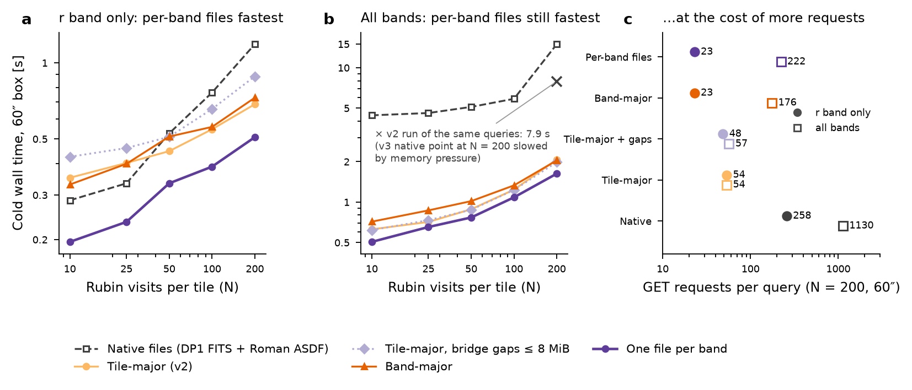

# Band ordering inside the joint sky-tiled store (benchmark v3)

Follow-up to [report_v2.md](report_v2.md). Same inputs: 200 real Rubin DP1 `visit_image`s and 18 Roman I-Sim L2 `_cal.asdf` files (WCS re-anchored onto the DP1 patch), stored as exact-ownership HEALPix order-14 (13″) stamps. The workspace had been cleaned, so all inputs were re-fetched; the DP1 re-stream reproduced v2 exactly (7.98 GB, 2,127 range requests, 0 errors).

**Question.** In v2, single-band (r-only) box queries were *slower* than reading the native files at shallow depth. I put that down to request count: with tile-major ordering, a 60″ box needed about 54 separate range reads. v3 tests four alternatives against the v2 layout.

## Layouts tested (all hold identical bytes and pixels)
| layout | what changes | files (N = 200) |
|---|---|---|
| **Tile-major** (v2) | rows ordered (tile, survey, band); one row group per tile × survey × band | 9 |
| **+ 1 MiB / 8 MiB gap bridging** | same files; the reader fetches straight through unwanted row groups if the gap is ≤ 1 MiB (the Rust `object_store` default) or ≤ 8 MiB | 9 |
| **Band-major** | same row groups, ordered (survey, band, tile), so one band's tiles are contiguous on disk | 9 |
| **One file per band** | a separate HATS-style tree per band (`band=r/Norder=10/…`), tile-major inside; bands fetched in parallel | 87 |

**Method.**
- **Testbed and positions:** the same S3 emulator as v1/v2 (30 ms to first byte, 90 MB/s per stream, 10 Gb/s link). Each box size uses 10 positions (5 for native), the first 10 of v2's positions.
- **Query types:** cold (no cached index) and warm, at depths N = 10, 25, 50, 100, 200 Rubin visits per tile.
- **Correctness:** every layout returned **bit-identical** pixels to direct reads of the original files (50 of 50 checks), and identical useful bytes to native for every paired query.
- **Native reproducibility:** native timings reproduce v2 to ±9% (median by depth). The one exception is marked * below: all-band, cold, 60″, N = 200 ran about 2× slower in v3 (median 15.0 s vs v2's 7.9 s). That run held the 200-visit stamp table in memory alongside 24 concurrent ASDF reads, so v2's value is the reliable one.

Code: [bench_v3.py](../code/bench_v3.py), [chunkbench.py](../code/chunkbench.py) (`write_hats_parquet_bandmajor`, `write_hats_parquet_perband`), [readers.py](../code/readers.py) (`max_gap`, `PerBandReader`). Results: [emu_results.parquet (v3)](../results/emu_results.parquet), [summary_v3.csv](../results/summary_v3.csv).

## Results
### r band only, cold: median wall time [s]
| layout | N=10, 5″ | N=10, 60″ | N=50, 5″ | N=50, 60″ | N=200, 5″ | N=200, 60″ | GETs (N=200, 60″) |
|---|---|---|---|---|---|---|---|
| Native files | 0.22 | 0.29 | 0.27 | 0.53 | 0.42 | 1.19 | 258 |
| Tile-major (v2) | 0.22 | 0.35 | 0.24 | 0.45 | 0.29 | 0.69 | 54 |
| Tile-major + 1 MiB gap bridging | 0.22 | 0.35 | 0.26 | 0.64 | 0.28 | 0.70 | 54 |
| Tile-major + 8 MiB gap bridging | 0.29 | 0.42 | 0.31 | 0.51 | 0.34 | 0.88 | 48 |
| Band-major | 0.22 | 0.33 | 0.27 | 0.51 | 0.30 | 0.73 | 23 |
| One file per band | 0.15 | 0.20 | 0.18 | 0.33 | 0.18 | 0.51 | 23 |

### All bands, cold: median wall time [s]
| layout | N=10, 5″ | N=10, 60″ | N=50, 5″ | N=50, 60″ | N=200, 5″ | N=200, 60″ | GETs (N=200, 60″) |
|---|---|---|---|---|---|---|---|
| Native files | 4.20 | 4.42 | 4.50 | 5.11 | 4.99 | 14.97* | 1130 |
| Tile-major (v2) | 0.27 | 0.63 | 0.32 | 0.88 | 0.58 | 2.07 | 54 |
| Tile-major + 1 MiB gap bridging | 0.27 | 0.61 | 0.32 | 0.86 | 0.47 | 1.97 | 54 |
| Tile-major + 8 MiB gap bridging | 0.32 | 0.62 | 0.35 | 0.88 | 0.48 | 1.99 | 57 |
| Band-major | 0.24 | 0.71 | 0.30 | 1.02 | 0.43 | 2.04 | 176 |
| One file per band | 0.22 | 0.51 | 0.26 | 0.77 | 0.35 | 1.63 | 222 |

\* memory-pressure outlier; v2 measured 7.9 s for the same queries.

## What the numbers say
1. **One file per band is fastest for both query types at every depth.**
   - *r only:* 0.15–0.51 s, beating native at every depth and box size. That is 1.4–1.6× at N = 10 and 2.1–2.3× at N = 200.
   - *All bands:* 5–20× faster than native (v2's timing used for the * cell), and 8–39% faster than tile-major.
2. **Band-major cut requests without cutting latency.** At 60″ it brought r-only requests from 54 to 17–23, but cold r-only time ranged from 6% faster to 24% slower than tile-major. On the emulator, parallel range requests are almost free, so **request count was not the cause of v2's single-band penalty.** My earlier explanation was wrong.
3. **The real cold cost is the Parquet footer.**
   - *Footer sizes:* one row group per tile × survey × band gives each order-10 partition file about 480 row groups and a median **376 KB footer**. Per-band files have about 97 row groups and a 78 KB footer.
   - *Effect on a cold 5″ r-only query at N = 10:* the extra (footer) bytes over warm are 1.9 MB for tile- and band-major against 0.2 MB for per-band files.
   - *Once footers are cached (warm):* tile-major is within 4% of native for r-only at N = 10 and 1.03–3.1× faster from N = 25 on (only 3% faster for 5″ boxes at N = 25, above 1.5× from N = 50).
4. **Gap bridging doesn't help.**
   - *1 MiB:* never triggers, because the other 11 bands between two r-band row groups exceed 1 MiB even at N = 10.
   - *8 MiB:* does merge, but reads 1.3–9× more bytes (N = 10, 60″: 91 MB vs 10 MB) and is slower in every r-only case.
5. **The cost of per-band files is request count on all-band queries.** At N = 200, 60″, an all-band query needs 222 GETs, against 54 for tile-major (and 1,130 native). Band-major needs 176. Storage size is the same for all layouts; per-band files use about 10× as many objects.

## Recommendation
- **Default layout: one object per (sky partition × band),** tile-major inside. It is the fastest layout for both single-band and multi-band pixel queries here, and it works with any reader that filters by path (`band=r/…`).
- **Keep footers small** with modest row-group counts per file, or publish a separate sidecar index (HATS-style `_metadata`, or a per-partition offset table) that clients cache. Cold queries then skip footer parsing, and this mostly removes the remaining gap to the warm numbers.
- **Watch the request budget for all-band AI loaders.** About 4× more GETs than tile-major means about 4× the GET charges. Real object stores also cap request rates per prefix (S3 documents about 5,500 GET/s per prefix). At about 200 GETs per query, that ceiling is roughly 25 all-band queries/s per prefix. Spreading partitions across prefixes, which HATS directory naming already does, avoids it. Tile-major remains the request-efficient choice if all-band access dominates and request cost matters more than latency.

## Caveats
- **Emulator timing only**, not real-cloud. The emulator treats parallel requests as free beyond a fixed first-byte delay. Real stores add tail latency that grows with the number of parallel requests, which would narrow per-band's lead on all-band queries. Byte and request counts are exact.
- **Native Rubin reads at depth use stand-ins:** 24 byte-identical local DP1 files stand in for the 200 visits. The tile stores hold all 200 real visits.
- **Simulated Roman pixels** (STScI I-Sim), repositioned on the sky. Only 6 Rubin bands + 6 Roman filters were tested; more filters would raise per-band request counts proportionally.
