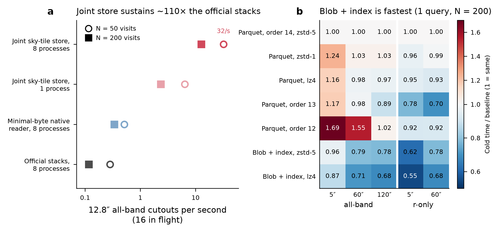

# Joint sky-tile store — optimizations and AI-style load on real S3 (v5)

**Context.** v4 showed that on AWS (us-east-2, m7i.2xlarge, real S3) the joint HEALPix tile store beats the official stacks on cold single queries ([report_v4.md](report_v4.md)). The official stacks are the LSST Butler and `roman_datamodels`. Before teardown, v5 tested three questions on the same instance and data:
1. Process-parallel decode.
2. AI-style concurrent load: 16 queries in flight, against every reader.
3. Layout variants: compression codec, HEALPix tile order, and an index-sidecar "blob" layout that replaces Parquet footers and pyarrow decode.

**Answer.**
- **Under AI-style load the joint store delivers about 110× the throughput of the official stacks** (114× at N=50 visits, 109× at N=200), with 93–205× fewer bytes per query. Against the minimal-byte native reader the margin is 38–62×.
- **Throughput comes from process-per-query parallelism:** 8 worker processes give 5.0–5.4× the throughput of one process. Splitting one query across processes does not help.
- **The blob + index layout is the best layout change.** It is 21–22% faster per cold query at 60–120″ for the same bytes, and up to 32% faster with lz4 for about 20% more bytes.
- Coarser tiles, lighter zstd and lz4-in-Parquet are not worth adopting.

## 1. AI-style concurrent load

Workload:
- 12.8″ boxes at random positions inside the 4′ patch (seed 7, the same positions as the v2 emulator test), all bands (Rubin + Roman).
- 16 queries in flight, run DataLoader-style: 8 long-lived worker processes × 2 queries each.
- Readers persist per worker, so indexes and footers are cached after first use.
- 300 queries for tiled readers; 50–100 for native and official readers.

From [summary_v5_ai.csv](../results/summary_v5_ai.csv):

| reader | N=50 q/s | N=50 MB/query | N=200 q/s | N=200 MB/query |
|---|---|---|---|---|
| joint tile-major store, 8 processes | **32.0** (p50 0.42 s, p95 0.87 s) | 16.1 | **12.7** (p50 1.16 s, p95 1.77 s) | 43.0 |
| joint tile-major store, 1 process (16 threads) | 6.40 | 16.0 | 2.34 | 43.2 |
| minimal-byte native reader, 8 processes | 0.51 | 2,191 | 0.34 | 2,454 |
| Butler `get(bbox)`, 1 MiB reads, 8 processes (Rubin part only) | 0.68 | 233 | 0.15 | 942 |
| `roman_datamodels`, 8 processes (Roman part only) | 0.48 | 3,074 | (same 18 SCAs) | 3,074 |
| **official stacks, joint** (Butler + Roman sharing the machine) | **0.28** | 3,307 | **0.12** | 4,016 |

Notes:
- **Official joint throughput is derived, not measured.** It is 1/(1/q_Butler + 1/q_Roman): each part was measured using the whole machine, so the two must share it for a joint query.
- **Useful bytes reconcile.** Butler 2.45 MB plus Roman 2.52 MB equals the tiled store's 4.97 MB of returned pixels per query at N=50.
- **Emulator vs real S3:**
  - The v2 emulator gave 3.55 q/s for the single-process joint reader at 16 in flight (N=200, about 43 MB/q). Real S3 gives 2.34 q/s, or 0.66×.
  - v2's often-quoted 40× over native (4.85 vs 0.12 q/s) was measured at **4** in flight. Native was not run at 16 in flight in v2.
- **What caps the 8-process runs is not established.** All tiled layouts converge to 12–13 q/s at N=200, about 540 MB/s received, so something is shared. Candidates are CPU (8 vCPU) or network; per-process CPU was not recorded in this harness.
- **AI runs with a WCS lock** (`AI_WCS_LOCK`, see §4), N=200, 8 processes:
  - tile-major Parquet 12.28 q/s, against 12.69 unlocked (3% lower);
  - blob + index, zstd-5: 12.71 q/s;
  - blob + index, lz4: 13.12 q/s at 51.9 MB/q;
  - Parquet order 13: 9.03 q/s at 80.9 MB/q.

## 2. Process-parallel decode of a single query

`joint2.ParallelTiled` works as follows:
- It splits a query's tiles into NESTED-contiguous chunks, one per worker; there are 8 workers.
- Each worker fetches, decodes and pastes its chunk, then returns each plane cropped to its coverage box, with a packed coverage mask.
- The parent merges the pieces using the masks. Output is bit-identical to the single-process reader (validated for every layout).

Cold all-band wall time in seconds, at 5″ / 60″ / 120″ (from [summary_v5_grid.csv](../results/summary_v5_grid.csv)):

| store | single process | 8 processes |
|---|---|---|
| tile-major, N=50 | 0.27 / 1.07 / 3.16 | 0.37 / 1.08 / 2.94 |
| tile-major, N=200 | 0.48 / 2.73 / 8.35 | 0.53 / 2.40 / 7.73 |

The gain is at most 12%, and small boxes get slower. Likely costs, not profiled:
- each worker re-reads cold footers;
- moving up to 1.3 GB of pixels back to the parent through pipes;
- merging them there.

**Conclusion:** parallelize across queries (the DataLoader pattern, §1), not within a query. Beyond that, a compiled decode-and-paste path is the remaining lever for single-query latency: in v4 the single-process reader used about 1.3 CPU-s per wall-s at 120″, mostly, I infer, in the Python per-stamp decode-and-paste loop.

## 3. Layout variants (N=200, built once from the same pixels)

The variants were built on the instance in 468 s (one 7.98 GB pixel extraction, then 6 stores; [build_variants.log](../results/build_variants.log)). Times are cold, single process, all-band, at 5″ / 60″ / 120″:

| variant | store size | cold time (s) | bytes received (MB) |
|---|---|---|---|
| Parquet, order 14, zstd-5 + bitshuffle (baseline) | 4.30 GB | 0.48 / 2.73 / 8.35 | 26 / 410 / 1,349 |
| Parquet, zstd-1 | 4.35 GB | 0.60 / 2.81 / 8.59 | 26 / 411 / 1,357 |
| Parquet, lz4 | 5.16 GB | 0.56 / 2.66 / 8.06 | 31 / 494 / 1,630 |
| Parquet, order 13 (26″ tiles) | 3.98 GB | 0.56 / 2.68 / 7.41 | 44 / 464 / 1,430 |
| Parquet, order 12 (52″ tiles) | 3.75 GB | 0.81 / 4.22 / 8.54 | 108 / 857 / 1,731 |
| **blob + index, zstd-5** | 4.29 GB | **0.46 / 2.15 / 6.51** | 26 / 406 / 1,342 |
| **blob + index, lz4** | 5.15 GB | **0.42 / 1.93 / 5.70** | 30 / 489 / 1,616 |

Single-band (r-only) at 5″ / 60″: baseline 0.27 / 0.79 s; blob zstd-5 0.17 / 0.61 s; blob lz4 0.15 / 0.54 s; order 13 0.21 / 0.55 s.

**What the blob layout is.** Each order-10 partition has two objects:
- `Npix=p.bin`: the same blosc2 stamp blobs as the Parquet store, in the same tile-major order.
- `Npix=p.idx`: an npz offset table holding tile, exposure, plane, dtype, pixel box, offset and length, plus the partition's exposure list.

How it reads, and why it is faster:
- A cold query reads one small index per partition, then contiguous byte ranges.
- No Parquet footer parse, no pyarrow decode and no `to_pydict` copy.
- That cuts 21–22% of cold wall time at 60–120″ for the same bytes. Per-process CPU was not measured, so the attribution to decode overhead is inferred.
- It is no longer HATS-Parquet-readable by generic tools. A hybrid would keep the Parquet files and add the `.idx` sidecar computed from them; the sidecar can carry Parquet page offsets.

**Order 13** helps only large boxes (120″: −11%) and r-only queries. It reads 1.7× the bytes at 5″ and lowers AI throughput by 29% (9.0 vs 12.7 q/s), so order 14 stays the default.

**Codecs:**
- **zstd-1 vs zstd-5:** no gain; the decode cost is the same.
- **lz4:** 20% larger stores and bytes. It helps only in the blob layout, where decode is a larger share of the time.

## 4. Engineering notes (for anyone re-running this)

- **astropy `WCS` objects are not thread-safe.** Concurrent `all_world2pix` on a shared object raised inside wcslib in one AI run (`blob_o14`). The harness option `AI_WCS_LOCK=1` serializes the WCS math. With it, tile-major Parquet ran at 12.28 q/s against 12.69 without, a 3% difference from one pair of runs.
- **`spawn`-based process pools need a `__main__` guard.** Without it, workers re-execute the benchmark script.
- **Parallel workers must return cropped planes, not full query boxes.** Returning full boxes multiplied peak memory by the worker count and OOM-killed the 31 GB instance twice.
- Long-lived pyarrow/numpy workers keep freed memory. `malloc_trim` after each task and `ARROW_DEFAULT_MEMORY_POOL=system` bounded the peak at about 11 GB in the final grid run (memory sampled every 30 s).

## 5. Recommendation for the joint store

1. **Layout:** order-14 tiles, tile-major. Use a blob + index layout, or a Parquet-plus-sidecar hybrid, so readers skip footers and pyarrow decode.
   - Codec: zstd-5 + bitshuffle when bytes or egress dominate cost; lz4 + bitshuffle for interactive or CPU-bound use.
2. **Serving:** process-per-query parallelism (DataLoader workers), one long-lived reader per process with cached indexes.
3. **Next lever:** a compiled decode-and-paste path (Rust/C++ via PyO3/pybind11, or numba) for the per-stamp loop. Measure per-process CPU under load to tell whether the 12–13 q/s cap at N=200 is CPU or network.
4. **Carry native WCS objects (GWCS / SkyWcs) per exposure** (report_v4 §5b).

## 6. Caveats

- One instance type (8 vCPU), one region, a 4′ patch; medians of 10 positions per cell (AI runs: 50–300 queries).
- Official joint AI throughput is derived from separate Rubin and Roman runs (§1).
- The baseline cold numbers here (e.g. 0.48 s at N=200, 5″) differ slightly from v4 (0.59 s), from run-to-run variation on S3. Comparisons inside this report use v5's own baseline.

## 7. Artifacts

- Figure: [fig_v5_ai_layouts.png](../figures/fig_v5_ai_layouts.png).
- Tables: [summary_v5_ai.csv](../results/summary_v5_ai.csv), [summary_v5_grid.csv](../results/summary_v5_grid.csv).
- Raw results: [aws_results_v5.parquet](../results/aws_results_v5.parquet), [aws_results_ai_all.parquet](../results/aws_results_ai_all.parquet).
- Code:
  - [joint2.py](../code/joint2.py): blob store, record assembler, `ParallelTiled`.
  - [aws_build_variants.py](../code/aws_build_variants.py).
  - [aws_bench_v5.py](../code/aws_bench_v5.py).
  - [aws_ai_load.py](../code/aws_ai_load.py).
  - [run_v5.sh](../code/run_v5.sh): its grid step failed, for lack of the main guard, and was re-run separately; its AI steps are the reported runs.
